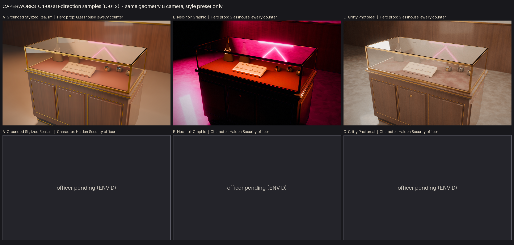

# C1-00 art-direction samples (input to D-012)

The hero prop, a Glasshouse jewelry counter, rendered in three styles. Everything is procedural:
Blender 4.5 Python, procedural shader nodes and a procedural world, with no downloaded assets.
**All three use the same geometry generator, camera and framing.** Only the style preset in
`tools/blender/style_samples/styles.py` changes: bevel width and segments, surface treatment
(clean, painterly or micro-detail), wear and grime, glass smudges and wipes, dust, brushed
anisotropic metal, velvet fuzz, micro-normal strength, fabric weave, refractive caustics, ink
outlines, lighting rig, practical intensity, colour grade and lens finish. The knobs that don't
apply to a style default to 0, so older callers keep working.

The officer (character) row is pending. Per D-027 it moved to ENV D. The contact sheet shows a
placeholder until `<style>/officer.png` exists. The generator scripts (`officer.py`, `head.py`)
are kept as a starting point.

Reproduce: `tools/blender/style_samples/render_all.sh`. This uses Cycles CPU with OIDN
denoising at 1600×1000, with 64 spp for GSR and noir and 96 spp for photoreal. Pass
`--scale 0.5 --samples 24` for previews and `ASSETS="counter officer"` to render both assets.

## Scaling each style to a full game made by AI agents

**A: Grounded Stylized Realism (`a_gsr`).** The look comes mostly from confident bevels, a small
clean material library and art-directed lighting, all of which parametric generators handle
well. It exports directly to `ORMMaterial3D` + glTF, and its mid-frequency detail is LOD-friendly.
Risk: without strong per-heist lighting and grading it can look generic. Cost: lowest.

**B: Neo-noir graphic (`b_noir`).** This style forgives procedural shortcuts the most. Hard rim
light, magenta/teal neon, crushed shadows, posterised painterly albedo and ink lines make simple
geometry look deliberate, and it has the strongest identity of the three. Risks: deep shadow works
against the competitive readability that `style_guide.md` requires; Godot needs a custom outline
post-shader and shared posterise shaders (the outlines here are Blender Freestyle); and every
level has to be lit with discipline. Cost: moderate and ongoing.

**C: Gritty photoreal (`c_photo`).** This is closest to the reference game. Props get micro
scratches, smudges, wipes and dust on the glass, anisotropic brushed brass, velvet fibre sheen,
dust on up-facing surfaces and grime in crevices. Lighting comes from physically plausible
softboxes and bounce, with refractive caustics, a lower exposure, chromatic aberration and grain. It is the hardest to scale procedurally, because noise-based detail reads as
procedural up close, and texture and shader budgets are the highest. **Humans carry the largest
risk (uncanny valley)**. Early officer tests with skin SSS and pores exposed every remaining error
in form, and we cannot use scanned or learned priors because of the no-third-party-assets rule.
Cost: highest, with the most uncertain outcome.

**Recommendation: A (GSR), using B's neon and grading language for per-heist mood.** GSR gives the
best quality for each hour of agent work and keeps gameplay readable. Photoreal is the most
impressive on props but the riskiest for characters.

## Caveats
Time-boxed to about 2 h. These are offline Cycles renders, so Godot needs equivalents for glass
refraction, outlines and grading. Jewelry is real-size at whole-counter framing, so rings and
chains are only a few dozen pixels across.

Known flaws in these renders:
- In `c_photo`, dust and fibre sheen make the black velvet busts read as grey.
- In `b_noir`, the teal rim is weak next to the magenta neon.
- `c_photo/counter.png` is a 256-colour dithered palette PNG. `post.py` falls back to this when
  film grain pushes the file past 2 MB.
