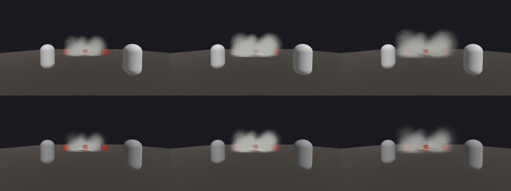

# D-163 VFX review: Sicario smoke cloud + Tag Team tether

Rendered by `game/world/tools/vfx_d163_review.tscn` (640x360, radius 4 m as B's smoke_radius_m), at 0.5 s (fade-in),
4.0 s (hold) and 9.0 s (fade-out) of a 10 s cloud. Top row Vulkan (Forward+), bottom row Compatibility (opengl3).
The red crates stand inside the cloud; the green line between the two capsules is the tether (motes pulse every 0.2 s).

