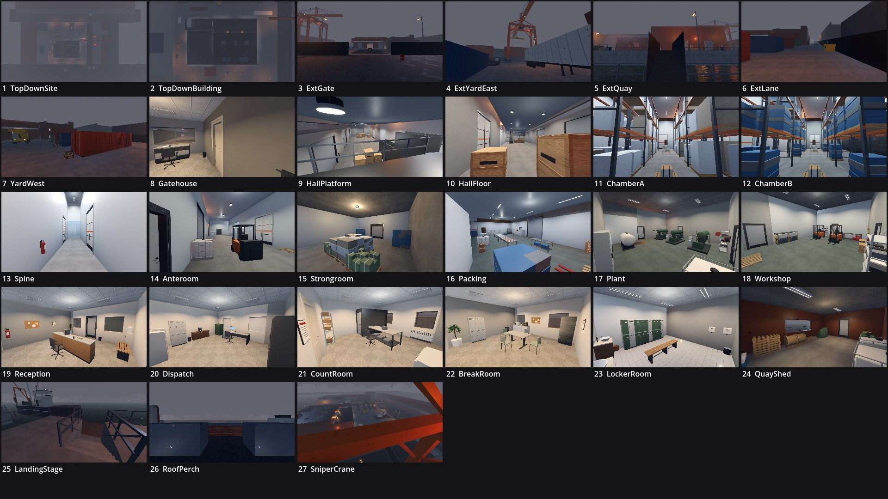

# Review shots: dockside_burn (g2)

Rendered by `tools/levelcheck/render_shots.sh` at 1920x1080. Contact sheet: `contact_sheet.jpg`.

| # | camera | caption | file | KB |
|---|---|---|---|---|
| 1 | TopDownSite | Top-down site: Pier 9 (building, yard, lane, apron, quay), Ferro St, Bellweather, the slip, Pier 10 | [top_down_site.jpg](top_down_site.jpg) | 58 |
| 2 | TopDownBuilding | Top-down building: office block (+7.2), hall (+6.6), high bay (+9.0), west wing (+5.8) | [top_down_building.jpg](top_down_building.jpg) | 76 |
| 3 | ExtGate | Exterior: from Ferro St through the gate: weighbridge, gatehouse, hall roller doors, the mural (landmark 1) | [ext_gate.jpg](ext_gate.jpg) | 129 |
| 4 | ExtYardEast | Exterior: from K6 east: apron, gangway, the Pier 10 crane over the slip (landmark 2) | [ext_yard_east.jpg](ext_yard_east.jpg) | 85 |
| 5 | ExtQuay | Exterior: from the pontoon: quay, net store, AN / PK doors, condenser plumes (landmark 3) | [ext_quay.jpg](ext_quay.jpg) | 109 |
| 6 | ExtLane | Exterior: west lane from the north end: the fire stair, Bellweather fence, E2 | [ext_lane.jpg](ext_lane.jpg) | 78 |
| 7 | YardWest | Yard west: K1-K3 alleys and D1 (player perch with the ladder) | [yard_west.jpg](yard_west.jpg) | 94 |
| 8 | Gatehouse | GH gatehouse (H4): console, window to the weighbridge | [gatehouse.jpg](gatehouse.jpg) | 134 |
| 9 | HallPlatform | H from the platform PF (H1): roller doors, the spine-aisle mouth | [hall_platform.jpg](hall_platform.jpg) | 143 |
| 10 | HallFloor | H from the dock door: the platform, its stair, the goods-lift hatch | [hall_floor.jpg](hall_floor.jpg) | 172 |
| 11 | ChamberA | C1 chamber A down the centre aisle (racking) | [chamber_a.jpg](chamber_a.jpg) | 202 |
| 12 | ChamberB | C2 chamber B down the centre aisle | [chamber_b.jpg](chamber_b.jpg) | 209 |
| 13 | Spine | SP spine aisle from the hall end (strip curtains) | [spine.jpg](spine.jpg) | 86 |
| 14 | Anteroom | AN anteroom (H2) from the east door: the vault door, quay roller doors, pallets | [anteroom.jpg](anteroom.jpg) | 126 |
| 15 | Strongroom | SR strongroom (vault): cash pallets, the vault door | [strongroom.jpg](strongroom.jpg) | 159 |
| 16 | Packing | PK packing hall: the packing line, quay doors | [packing.jpg](packing.jpg) | 132 |
| 17 | Plant | PL plant: compressors, the culvert grate | [plant.jpg](plant.jpg) | 144 |
| 18 | Workshop | WS workshop: forklifts on charge | [workshop.jpg](workshop.jpg) | 160 |
| 19 | Reception | O1 reception: counter, front door | [reception.jpg](reception.jpg) | 212 |
| 20 | Dispatch | O2 dispatch / security room: desk, dispatch safe | [dispatch.jpg](dispatch.jpg) | 200 |
| 21 | CountRoom | M1 count room (H1): counting table, the D-138 cash cage and its padlocked gate | [count_room.jpg](count_room.jpg) | 208 |
| 22 | BreakRoom | M2 break room | [break_room.jpg](break_room.jpg) | 220 |
| 23 | LockerRoom | LK locker room | [locker_room.jpg](locker_room.jpg) | 193 |
| 24 | QuayShed | QS quay net store (H3): the pontoon window | [quay_shed.jpg](quay_shed.jpg) | 147 |
| 25 | LandingStage | X4 quay steps down to the landing stage, P4 shed | [landing_stage.jpg](landing_stage.jpg) | 131 |
| 26 | RoofPerch | X5 office roof (player perch) toward the viaduct | [roof_perch.jpg](roof_perch.jpg) | 92 |
| 27 | SniperCrane | S1 crane cab: the Longshot's view over the yard and apron | [sniper_crane.jpg](sniper_crane.jpg) | 97 |

