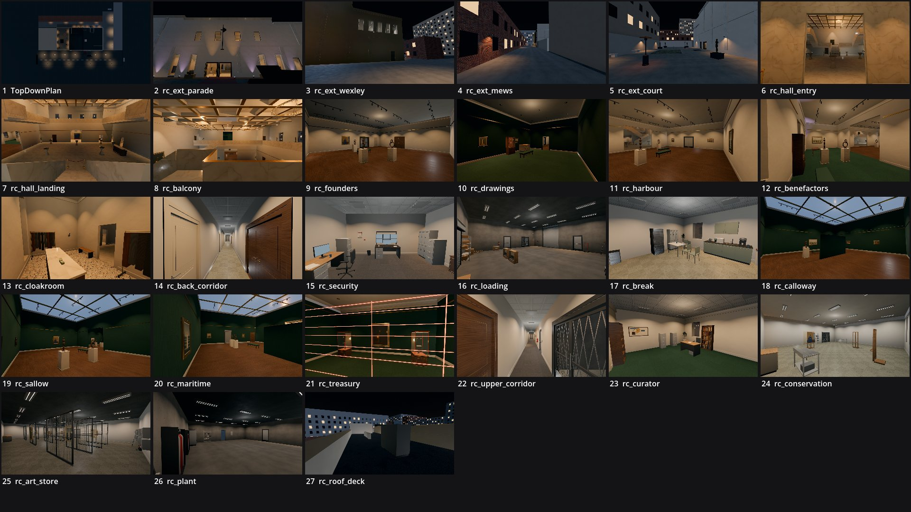

# Review shots: gallery_night (g2)

Rendered by `tools/levelcheck/render_shots.sh` at 1920x1080. Contact sheet: `contact_sheet.jpg`.

| # | camera | caption | file | KB |
|---|---|---|---|---|
| 1 | TopDownPlan | TopDownPlan () | [top_down_plan.jpg](top_down_plan.jpg) | 104 |
| 2 | rc_ext_parade | rc_ext_parade (X1) | [rc_ext_parade.jpg](rc_ext_parade.jpg) | 111 |
| 3 | rc_ext_wexley | rc_ext_wexley (X2) | [rc_ext_wexley.jpg](rc_ext_wexley.jpg) | 118 |
| 4 | rc_ext_mews | rc_ext_mews (X2) | [rc_ext_mews.jpg](rc_ext_mews.jpg) | 170 |
| 5 | rc_ext_court | rc_ext_court (X3) | [rc_ext_court.jpg](rc_ext_court.jpg) | 114 |
| 6 | rc_hall_entry | rc_hall_entry (VE) | [rc_hall_entry.jpg](rc_hall_entry.jpg) | 130 |
| 7 | rc_hall_landing | rc_hall_landing (GH) | [rc_hall_landing.jpg](rc_hall_landing.jpg) | 155 |
| 8 | rc_balcony | rc_balcony (BW) | [rc_balcony.jpg](rc_balcony.jpg) | 177 |
| 9 | rc_founders | rc_founders (WG) | [rc_founders.jpg](rc_founders.jpg) | 165 |
| 10 | rc_drawings | rc_drawings (DC) | [rc_drawings.jpg](rc_drawings.jpg) | 117 |
| 11 | rc_harbour | rc_harbour (EG) | [rc_harbour.jpg](rc_harbour.jpg) | 161 |
| 12 | rc_benefactors | rc_benefactors (EB) | [rc_benefactors.jpg](rc_benefactors.jpg) | 135 |
| 13 | rc_cloakroom | rc_cloakroom (CK) | [rc_cloakroom.jpg](rc_cloakroom.jpg) | 174 |
| 14 | rc_back_corridor | rc_back_corridor (BC) | [rc_back_corridor.jpg](rc_back_corridor.jpg) | 173 |
| 15 | rc_security | rc_security (SC) | [rc_security.jpg](rc_security.jpg) | 167 |
| 16 | rc_loading | rc_loading (LD) | [rc_loading.jpg](rc_loading.jpg) | 148 |
| 17 | rc_break | rc_break (BR) | [rc_break.jpg](rc_break.jpg) | 197 |
| 18 | rc_calloway | rc_calloway (UG1) | [rc_calloway.jpg](rc_calloway.jpg) | 174 |
| 19 | rc_sallow | rc_sallow (UG2) | [rc_sallow.jpg](rc_sallow.jpg) | 170 |
| 20 | rc_maritime | rc_maritime (UG3) | [rc_maritime.jpg](rc_maritime.jpg) | 168 |
| 21 | rc_treasury | rc_treasury (TR) | [rc_treasury.jpg](rc_treasury.jpg) | 213 |
| 22 | rc_upper_corridor | rc_upper_corridor (UC) | [rc_upper_corridor.jpg](rc_upper_corridor.jpg) | 200 |
| 23 | rc_curator | rc_curator (CO) | [rc_curator.jpg](rc_curator.jpg) | 177 |
| 24 | rc_conservation | rc_conservation (CS) | [rc_conservation.jpg](rc_conservation.jpg) | 180 |
| 25 | rc_art_store | rc_art_store (AS) | [rc_art_store.jpg](rc_art_store.jpg) | 250 |
| 26 | rc_plant | rc_plant (PL) | [rc_plant.jpg](rc_plant.jpg) | 117 |
| 27 | rc_roof_deck | rc_roof_deck (X4) | [rc_roof_deck.jpg](rc_roof_deck.jpg) | 123 |

