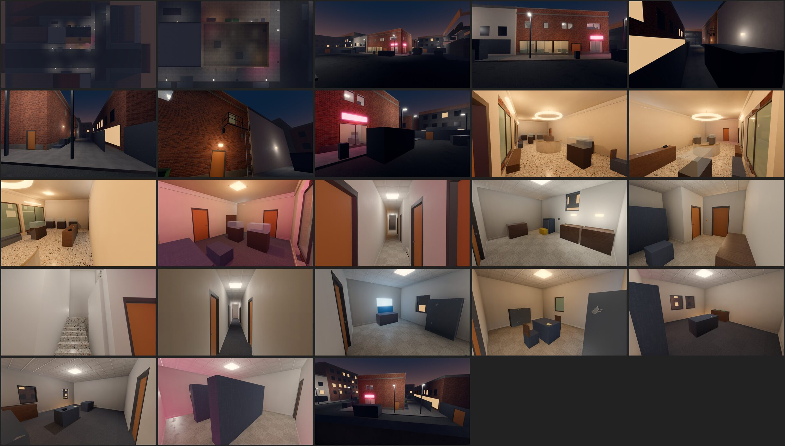

# Review shots: glasshouse (g2)

Rendered by `tools/levelcheck/render_shots.sh` at 1920x1080. Contact sheet: `contact_sheet.jpg`.

| # | camera | caption | file | KB |
|---|---|---|---|---|
| 1 | SalesFloorEntrance | G5 sales floor from the entrance (floor guard post view) | [sales_floor_entrance.jpg](sales_floor_entrance.jpg) | 182 |
| 2 | ChandelierLandmark | G5 chandelier display (landmark) and island cases | [chandelier_landmark.jpg](chandelier_landmark.jpg) | 164 |
| 3 | CounterStaffDoor | G5 sales counter, register, staff door behind it | [counter_staff_door.jpg](counter_staff_door.jpg) | 169 |
| 4 | SecurityOffice | U2 security office: camera station (P2), key cabinet, alley window | [security_office.jpg](security_office.jpg) | 136 |
| 5 | BreakRoom | U1 break room, fire-escape window, lockers | [break_room.jpg](break_room.jpg) | 135 |
| 6 | ManagerOffice | U6 manager office (keycard / cash slots) | [manager_office.jpg](manager_office.jpg) | 144 |
| 7 | AdminOffice | U5 admin and appraisal office | [admin_office.jpg](admin_office.jpg) | 162 |
| 8 | StockRoom | U7 stock and archive | [stock_room.jpg](stock_room.jpg) | 160 |
| 9 | GaragePerch | Garage level 2 (P3 sniper perch) toward the alley mouth and salon | [garage_perch.jpg](garage_perch.jpg) | 160 |

