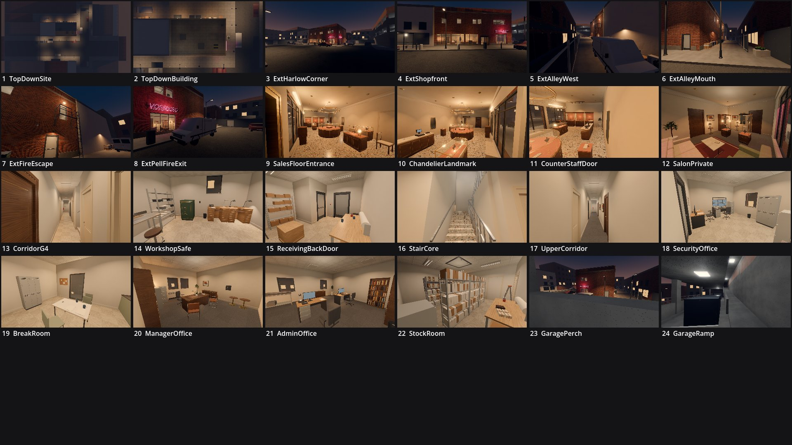

# Review shots: glasshouse (g2)

Rendered by `tools/levelcheck/render_shots.sh` at 1920x1080. Contact sheet: `contact_sheet.jpg`.

| # | camera | caption | file | KB |
|---|---|---|---|---|
| 1 | TopDownSite | Top-down site: building, alley, Harlow Ave, Pell St, closures | [top_down_site.jpg](top_down_site.jpg) | 84 |
| 2 | TopDownBuilding | Top-down building footprint (roof, parapet, HVAC, hatch) | [top_down_building.jpg](top_down_building.jpg) | 106 |
| 3 | ExtHarlowCorner | Exterior: Harlow Ave / Pell St corner, neon sign + salon glazing (landmark) | [ext_harlow_corner.jpg](ext_harlow_corner.jpg) | 129 |
| 4 | ExtShopfront | Exterior: shopfront from Harlow Ave; chandelier display visible through the glass | [ext_shopfront.jpg](ext_shopfront.jpg) | 223 |
| 5 | ExtAlleyWest | Exterior: service alley from the west (van E1 slot, back door, dumpsters, fire escape) | [ext_alley_west.jpg](ext_alley_west.jpg) | 106 |
| 6 | ExtAlleyMouth | Exterior: alley mouth from Pell St | [ext_alley_mouth.jpg](ext_alley_mouth.jpg) | 237 |
| 7 | ExtFireEscape | Exterior: fire-escape ladder + landing under the break-room window | [ext_fire_escape.jpg](ext_fire_escape.jpg) | 274 |
| 8 | ExtPellFireExit | Exterior: Pell St side, fire exit + van E2 slot | [ext_pell_fire_exit.jpg](ext_pell_fire_exit.jpg) | 230 |
| 9 | SalesFloorEntrance | G5 sales floor from the entrance (floor guard post view) | [sales_floor_entrance.jpg](sales_floor_entrance.jpg) | 255 |
| 10 | ChandelierLandmark | G5 chandelier display (landmark) and island cases | [chandelier_landmark.jpg](chandelier_landmark.jpg) | 231 |
| 11 | CounterStaffDoor | G5 sales counter, register, staff door behind it | [counter_staff_door.jpg](counter_staff_door.jpg) | 204 |
| 12 | SalonPrivate | G6 private salon (variable lock), cases, vitrine | [salon_private.jpg](salon_private.jpg) | 193 |
| 13 | CorridorG4 | G4 staff corridor: the 18 m sightline (stealth crux) | [corridor_g_4.jpg](corridor_g_4.jpg) | 143 |
| 14 | WorkshopSafe | G2 workshop: the safe, keycard reader, jeweler benches | [workshop_safe.jpg](workshop_safe.jpg) | 181 |
| 15 | ReceivingBackDoor | G1 receiving, back door to the alley, G7 electrical door | [receiving_back_door.jpg](receiving_back_door.jpg) | 158 |
| 16 | StairCore | G8 U-stair from the corridor foot | [stair_core.jpg](stair_core.jpg) | 116 |
| 17 | UpperCorridor | U4 upper corridor and void railing | [upper_corridor.jpg](upper_corridor.jpg) | 88 |
| 18 | SecurityOffice | U2 security office: camera station (P2), key cabinet, alley window | [security_office.jpg](security_office.jpg) | 163 |
| 19 | BreakRoom | U1 break room, fire-escape window, lockers | [break_room.jpg](break_room.jpg) | 139 |
| 20 | ManagerOffice | U6 manager office (keycard / cash slots) | [manager_office.jpg](manager_office.jpg) | 180 |
| 21 | AdminOffice | U5 admin and appraisal office | [admin_office.jpg](admin_office.jpg) | 198 |
| 22 | StockRoom | U7 stock and archive | [stock_room.jpg](stock_room.jpg) | 199 |
| 23 | GaragePerch | Garage level 2 (P3 sniper perch), crouched eye over the 1.0 m parapet: alley mouth and salon | [garage_perch.jpg](garage_perch.jpg) | 132 |
| 24 | GarageRamp | Garage L2 -> L3 ramp from its foot: upstand, L3 cut-out railing, stalls | [garage_ramp.jpg](garage_ramp.jpg) | 138 |

