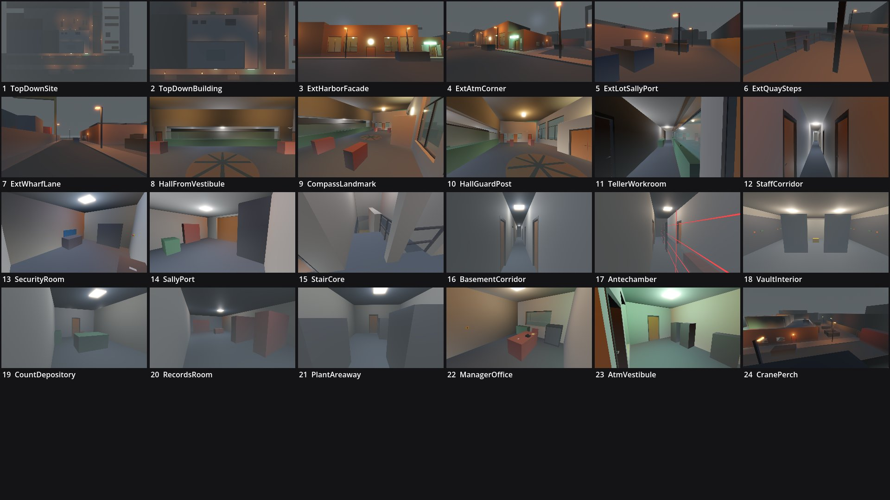

# Review shots: night_deposit (g1)

Rendered by `tools/levelcheck/render_shots.sh` at 1920x1080. Contact sheet: `contact_sheet.jpg`.

| # | camera | caption | file | KB |
|---|---|---|---|---|
| 1 | TopDownSite | Top-down site: bank, lot + alley, Wharf Lane, Harbor St, quay, closures | [top_down_site.jpg](top_down_site.jpg) | 55 |
| 2 | TopDownBuilding | Top-down building: stepped massing (hall +6.5, wing +3.6), roof plant, skylight | [top_down_building.jpg](top_down_building.jpg) | 63 |
| 3 | ExtHarborFacade | Exterior: Harbor St facade from the quay: harbor clock, bronze doors, tall hall windows (landmark) | [ext_harbor_facade.jpg](ext_harbor_facade.jpg) | 79 |
| 4 | ExtAtmCorner | Exterior: Harbor St / Wharf Ln corner: green-glass ATM vestibule (landmark), fire exit side | [ext_atm_corner.jpg](ext_atm_corner.jpg) | 79 |
| 5 | ExtLotSallyPort | Exterior: staff lot from the alley mouth: sally roller + personnel door, van E1 slot, dumpster, areaway cage | [ext_lot_sally_port.jpg](ext_lot_sally_port.jpg) | 60 |
| 6 | ExtQuaySteps | Exterior: quay steps, landing and the moored launch (E2), chain railing | [ext_quay_steps.jpg](ext_quay_steps.jpg) | 59 |
| 7 | ExtWharfLane | Exterior: Wharf Lane from the trailer closure: crane yard palisade, bank east side | [ext_wharf_lane.jpg](ext_wharf_lane.jpg) | 64 |
| 8 | HallFromVestibule | G9 banking hall from the vestibule: teller counter + bandit glass, compass rose | [hall_from_vestibule.jpg](hall_from_vestibule.jpg) | 75 |
| 9 | CompassLandmark | G9 mosaic compass rose (landmark), check tables, the hall guard post | [compass_landmark.jpg](compass_landmark.jpg) | 86 |
| 10 | HallGuardPost | G9 hall guard post view east: ATM glass door, G11/G12 glass fronts | [hall_guard_post.jpg](hall_guard_post.jpg) | 90 |
| 11 | TellerWorkroom | G8 teller workroom behind the counter (hidden from the seated hall guard) | [teller_workroom.jpg](teller_workroom.jpg) | 75 |
| 12 | StaffCorridor | G7 staff corridor: the 26 m sightline | [staff_corridor.jpg](staff_corridor.jpg) | 64 |
| 13 | SecurityRoom | G3 security room: camera station against the west wall | [security_room.jpg](security_room.jpg) | 62 |
| 14 | SallyPort | G1 sally port: roller + personnel door, cash lift | [sally_port.jpg](sally_port.jpg) | 60 |
| 15 | StairCore | G2 U-stair from the corridor (railing over flight 2) | [stair_core.jpg](stair_core.jpg) | 59 |
| 16 | BasementCorridor | B5 basement spine and the vault gate | [basement_corridor.jpg](basement_corridor.jpg) | 59 |
| 17 | Antechamber | B8 antechamber: laser plane, time-lock panel, vault door | [antechamber.jpg](antechamber.jpg) | 72 |
| 18 | VaultInterior | B9 vault: cash cage, Co-op pallet, deposit box walls | [vault_interior.jpg](vault_interior.jpg) | 61 |
| 19 | CountDepository | B11 count room and B12 depository safe | [count_depository.jpg](count_depository.jpg) | 52 |
| 20 | RecordsRoom | B6 records: compact shelving, microfiche desk | [records_room.jpg](records_room.jpg) | 48 |
| 21 | PlantAreaway | B3 plant room and the areaway door | [plant_areaway.jpg](plant_areaway.jpg) | 50 |
| 22 | ManagerOffice | G12 manager office: desk, manager safe slot | [manager_office.jpg](manager_office.jpg) | 63 |
| 23 | AtmVestibule | G13 ATM vestibule (24 h, PUBLIC): ATMs, night drop, hall door | [atm_vestibule.jpg](atm_vestibule.jpg) | 85 |
| 24 | CranePerch | Crane office roof (P3 sniper perch) over the lot and sally door | [crane_perch.jpg](crane_perch.jpg) | 71 |

