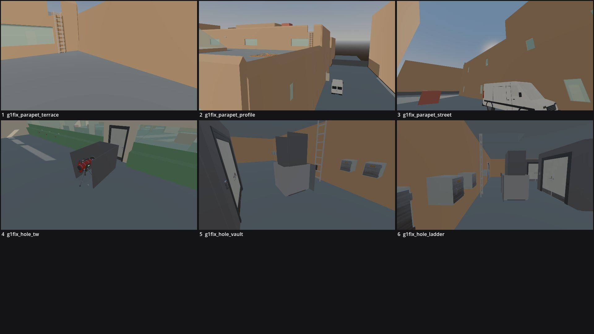

# Review shots: OstranderFederal (g1)

Rendered by `tools/levelcheck/render_shots.sh` at 1920x1080. Contact sheet: `contact_sheet.jpg`.

| # | camera | caption | file | KB |
|---|---|---|---|---|
| 1 | g1fix_parapet_terrace | Terrace east parapet from the terrace: 1.1 m guard, solid to 0.5 m, mono coping falling outward (E2 throw spot) | [g_1_fix_parapet_terrace.jpg](g_1_fix_parapet_terrace.jpg) | 48 |
| 2 | g1fix_parapet_profile | Terrace east parapet from Tannery St (SE): the outward-falling coping in profile above the hall's east wall | [g_1_fix_parapet_profile.jpg](g_1_fix_parapet_profile.jpg) | 66 |
| 3 | g1fix_parapet_street | Tannery St: the E2 strip below the parapet's south end (the van at x 51.2), the throw spot above | [g_1_fix_parapet_street.jpg](g_1_fix_parapet_street.jpg) | 60 |
| 4 | g1fix_hole_tw | TW after the burn: the hole, the 1.5 m guard screens W / E / S, the open N edge with the rope ladder top | [g_1_fix_hole_tw.jpg](g_1_fix_hole_tw.jpg) | 58 |
| 5 | g1fix_hole_vault | VT: the hoist shaft open to the south over the 0.6 m sill, the backstop, the car; the ladder beyond the backstop | [g_1_fix_hole_vault.jpg](g_1_fix_hole_vault.jpg) | 59 |
| 6 | g1fix_hole_ladder | VT: the rope ladder strip north of the shaft (Bottom 1.01 m clear of the car), the vault wall behind | [g_1_fix_hole_ladder.jpg](g_1_fix_hole_ladder.jpg) | 58 |

