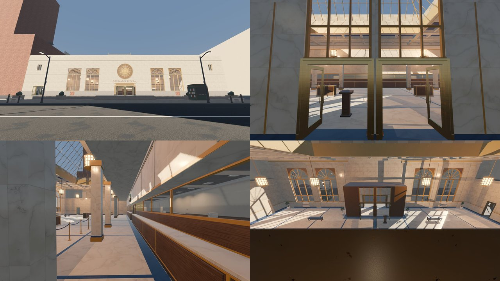

# Review shots: ostrander_federal (g2, lane A: BH / VE / X1)

Rendered by `tools/levelcheck/render_shots.sh ostrander_federal g2 --out=<g2/a> --cameras=...` (LC_DRIVER=opengl3, 1920x1080) at env/c-worlds 334ff3f0 (lane A + lighting + surfaces/vault merged). `rc_vestibule` is still to come: renders paused for the shadow perf rework (coordinator).

| # | camera | covers | file | KB |
|---|---|---|---|---|
| 1 | rc_ext_plaza | X1 | [rc_ext_plaza.jpg](rc_ext_plaza.jpg) | 238 |
| 2 | rc_hall_entrance | VE -> BH | [rc_hall_entrance.jpg](rc_hall_entrance.jpg) | 190 |
| 3 | rc_hall_counter | BH | [rc_hall_counter.jpg](rc_hall_counter.jpg) | 192 |
| 4 | rc_hall_from_gallery | GA -> BH | [rc_hall_from_gallery.jpg](rc_hall_from_gallery.jpg) | 216 |

