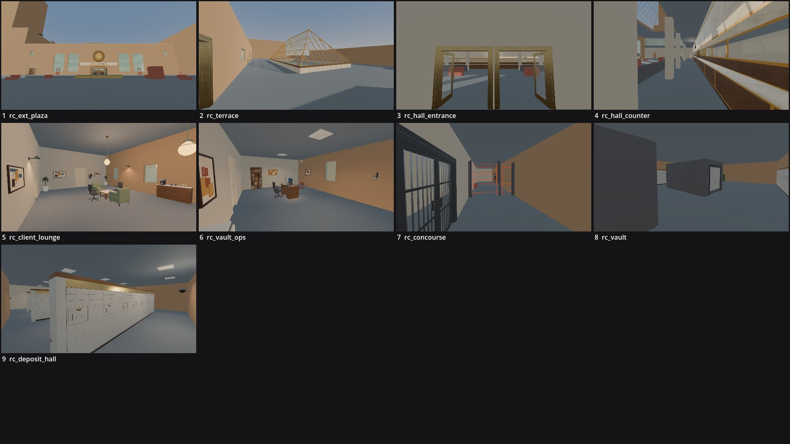

# Review shots: ostrander_federal (g2)

Rendered by `tools/levelcheck/render_shots.sh` at 1920x1080. Contact sheet: `contact_sheet.jpg`.

| # | camera | caption | file | KB |
|---|---|---|---|---|
| 1 | rc_ext_plaza | rc_ext_plaza (X1) | [rc_ext_plaza.jpg](rc_ext_plaza.jpg) | 68 |
| 2 | rc_terrace | rc_terrace (X4) | [rc_terrace.jpg](rc_terrace.jpg) | 105 |
| 3 | rc_hall_entrance | rc_hall_entrance (VE) | [rc_hall_entrance.jpg](rc_hall_entrance.jpg) | 81 |
| 4 | rc_hall_counter | rc_hall_counter (BH) | [rc_hall_counter.jpg](rc_hall_counter.jpg) | 123 |
| 5 | rc_client_lounge | rc_client_lounge (PC) | [rc_client_lounge.jpg](rc_client_lounge.jpg) | 94 |
| 6 | rc_vault_ops | rc_vault_ops (VO) | [rc_vault_ops.jpg](rc_vault_ops.jpg) | 83 |
| 7 | rc_concourse | rc_concourse (VC) | [rc_concourse.jpg](rc_concourse.jpg) | 94 |
| 8 | rc_vault | rc_vault (VT) | [rc_vault.jpg](rc_vault.jpg) | 47 |
| 9 | rc_deposit_hall | rc_deposit_hall (SD) | [rc_deposit_hall.jpg](rc_deposit_hall.jpg) | 96 |

