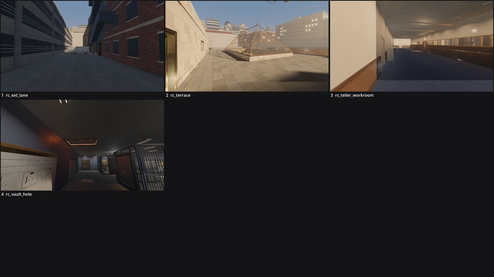

# Review shots: OstranderFederal (g1)

Rendered by `tools/levelcheck/render_shots.sh` at 1920x1080. Contact sheet: `contact_sheet.jpg`.

| # | camera | caption | file | KB |
|---|---|---|---|---|
| 1 | rc_ext_lane | rc_ext_lane (X2) | [rc_ext_lane.jpg](rc_ext_lane.jpg) | 162 |
| 2 | rc_terrace | rc_terrace (X4) | [rc_terrace.jpg](rc_terrace.jpg) | 244 |
| 3 | rc_teller_workroom | rc_teller_workroom (TW) | [rc_teller_workroom.jpg](rc_teller_workroom.jpg) | 176 |
| 4 | rc_vault_hole | rc_vault_hole (VT) | [rc_vault_hole.jpg](rc_vault_hole.jpg) | 196 |

