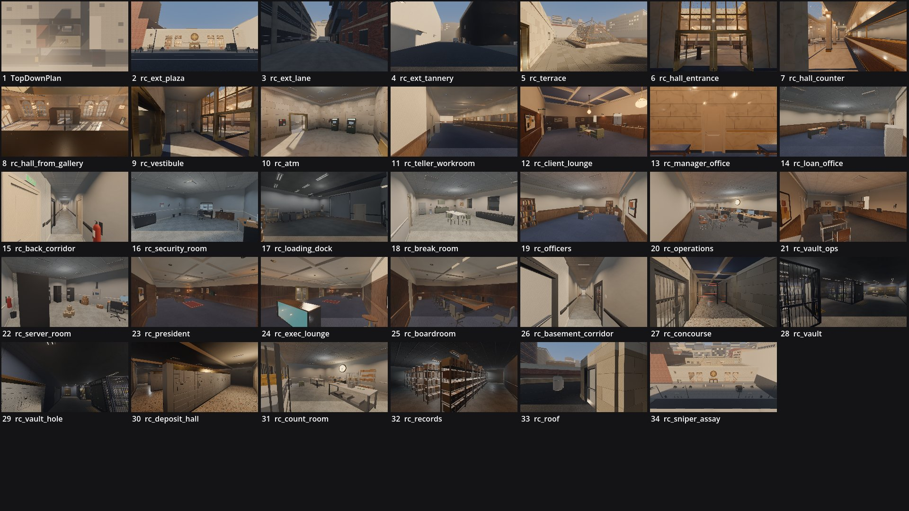

# Review shots: ostrander_federal (g2)

Rendered by `tools/levelcheck/render_shots.sh` at 1920x1080. Contact sheet: `contact_sheet.jpg`.

| # | camera | caption | file | KB |
|---|---|---|---|---|
| 1 | TopDownPlan | TopDownPlan () | [top_down_plan.jpg](top_down_plan.jpg) | 139 |
| 2 | rc_ext_plaza | rc_ext_plaza (X1) | [rc_ext_plaza.jpg](rc_ext_plaza.jpg) | 196 |
| 3 | rc_ext_lane | rc_ext_lane (X2) | [rc_ext_lane.jpg](rc_ext_lane.jpg) | 162 |
| 4 | rc_ext_tannery | rc_ext_tannery (X3) | [rc_ext_tannery.jpg](rc_ext_tannery.jpg) | 128 |
| 5 | rc_terrace | rc_terrace (X4) | [rc_terrace.jpg](rc_terrace.jpg) | 241 |
| 6 | rc_hall_entrance | rc_hall_entrance (VE) | [rc_hall_entrance.jpg](rc_hall_entrance.jpg) | 191 |
| 7 | rc_hall_counter | rc_hall_counter (BH) | [rc_hall_counter.jpg](rc_hall_counter.jpg) | 222 |
| 8 | rc_hall_from_gallery | rc_hall_from_gallery (GA) | [rc_hall_from_gallery.jpg](rc_hall_from_gallery.jpg) | 189 |
| 9 | rc_vestibule | rc_vestibule (VE) | [rc_vestibule.jpg](rc_vestibule.jpg) | 195 |
| 10 | rc_atm | rc_atm (AV) | [rc_atm.jpg](rc_atm.jpg) | 152 |
| 11 | rc_teller_workroom | rc_teller_workroom (TW) | [rc_teller_workroom.jpg](rc_teller_workroom.jpg) | 176 |
| 12 | rc_client_lounge | rc_client_lounge (PC) | [rc_client_lounge.jpg](rc_client_lounge.jpg) | 169 |
| 13 | rc_manager_office | rc_manager_office (BH) | [rc_manager_office.jpg](rc_manager_office.jpg) | 125 |
| 14 | rc_loan_office | rc_loan_office (LO) | [rc_loan_office.jpg](rc_loan_office.jpg) | 237 |
| 15 | rc_back_corridor | rc_back_corridor (BC) | [rc_back_corridor.jpg](rc_back_corridor.jpg) | 172 |
| 16 | rc_security_room | rc_security_room (SR) | [rc_security_room.jpg](rc_security_room.jpg) | 190 |
| 17 | rc_loading_dock | rc_loading_dock (LD) | [rc_loading_dock.jpg](rc_loading_dock.jpg) | 126 |
| 18 | rc_break_room | rc_break_room (BR) | [rc_break_room.jpg](rc_break_room.jpg) | 197 |
| 19 | rc_officers | rc_officers (AO2) | [rc_officers.jpg](rc_officers.jpg) | 184 |
| 20 | rc_operations | rc_operations (OF) | [rc_operations.jpg](rc_operations.jpg) | 174 |
| 21 | rc_vault_ops | rc_vault_ops (VO) | [rc_vault_ops.jpg](rc_vault_ops.jpg) | 178 |
| 22 | rc_server_room | rc_server_room (SV) | [rc_server_room.jpg](rc_server_room.jpg) | 169 |
| 23 | rc_president | rc_president (PR) | [rc_president.jpg](rc_president.jpg) | 135 |
| 24 | rc_exec_lounge | rc_exec_lounge (XL) | [rc_exec_lounge.jpg](rc_exec_lounge.jpg) | 165 |
| 25 | rc_boardroom | rc_boardroom (BD) | [rc_boardroom.jpg](rc_boardroom.jpg) | 161 |
| 26 | rc_basement_corridor | rc_basement_corridor (BB) | [rc_basement_corridor.jpg](rc_basement_corridor.jpg) | 182 |
| 27 | rc_concourse | rc_concourse (VC) | [rc_concourse.jpg](rc_concourse.jpg) | 253 |
| 28 | rc_vault | rc_vault (VT) | [rc_vault.jpg](rc_vault.jpg) | 231 |
| 29 | rc_vault_hole | rc_vault_hole (VT) | [rc_vault_hole.jpg](rc_vault_hole.jpg) | 188 |
| 30 | rc_deposit_hall | rc_deposit_hall (SD) | [rc_deposit_hall.jpg](rc_deposit_hall.jpg) | 230 |
| 31 | rc_count_room | rc_count_room (CP) | [rc_count_room.jpg](rc_count_room.jpg) | 219 |
| 32 | rc_records | rc_records (RC) | [rc_records.jpg](rc_records.jpg) | 255 |
| 33 | rc_roof | rc_roof (X5) | [rc_roof.jpg](rc_roof.jpg) | 202 |
| 34 | rc_sniper_assay | rc_sniper_assay (X1) | [rc_sniper_assay.jpg](rc_sniper_assay.jpg) | 217 |

