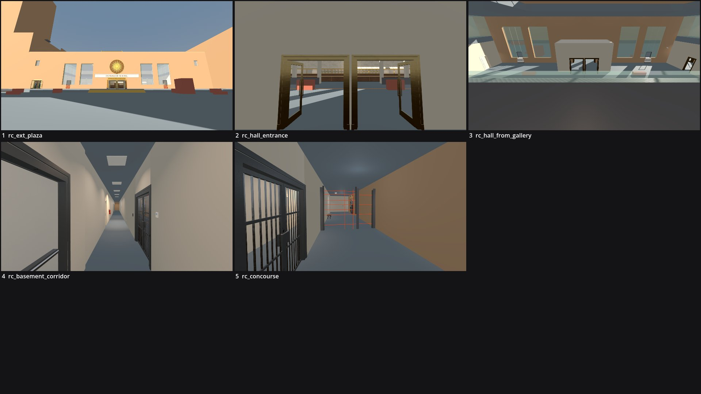

# Review shots: ostrander_federal (g2)

Rendered by `tools/levelcheck/render_shots.sh` at 1920x1080. Contact sheet: `contact_sheet.jpg`.

| # | camera | caption | file | KB |
|---|---|---|---|---|
| 1 | rc_ext_plaza | rc_ext_plaza (X1) | [rc_ext_plaza.jpg](rc_ext_plaza.jpg) | 85 |
| 2 | rc_hall_entrance | rc_hall_entrance (VE) | [rc_hall_entrance.jpg](rc_hall_entrance.jpg) | 85 |
| 3 | rc_hall_from_gallery | rc_hall_from_gallery (GA) | [rc_hall_from_gallery.jpg](rc_hall_from_gallery.jpg) | 92 |
| 4 | rc_basement_corridor | rc_basement_corridor (BB) | [rc_basement_corridor.jpg](rc_basement_corridor.jpg) | 85 |
| 5 | rc_concourse | rc_concourse (VC) | [rc_concourse.jpg](rc_concourse.jpg) | 110 |

