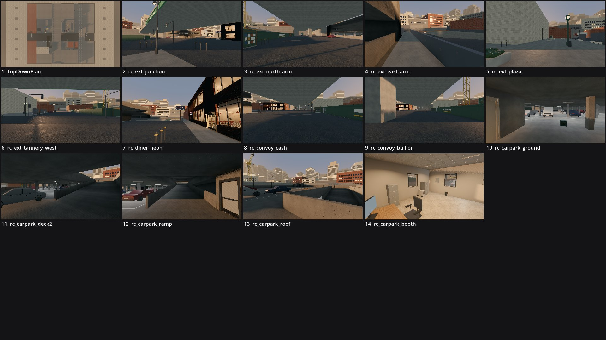

# Review shots: rolling_thunder (final)

Rendered by `tools/levelcheck/render_shots.sh` at 1920x1080. Contact sheet: `contact_sheet.jpg`.

| # | camera | caption | file | KB |
|---|---|---|---|---|
| 1 | TopDownPlan | TopDownPlan () | [top_down_plan.jpg](top_down_plan.jpg) | 198 |
| 2 | rc_ext_junction | rc_ext_junction (X3) | [rc_ext_junction.jpg](rc_ext_junction.jpg) | 221 |
| 3 | rc_ext_north_arm | rc_ext_north_arm (X1) | [rc_ext_north_arm.jpg](rc_ext_north_arm.jpg) | 252 |
| 4 | rc_ext_east_arm | rc_ext_east_arm (X6) | [rc_ext_east_arm.jpg](rc_ext_east_arm.jpg) | 203 |
| 5 | rc_ext_plaza | rc_ext_plaza (X3) | [rc_ext_plaza.jpg](rc_ext_plaza.jpg) | 188 |
| 6 | rc_ext_tannery_west | rc_ext_tannery_west (X1) | [rc_ext_tannery_west.jpg](rc_ext_tannery_west.jpg) | 306 |
| 7 | rc_diner_neon | rc_diner_neon (X1) | [rc_diner_neon.jpg](rc_diner_neon.jpg) | 255 |
| 8 | rc_convoy_cash | rc_convoy_cash (X1) | [rc_convoy_cash.jpg](rc_convoy_cash.jpg) | 210 |
| 9 | rc_convoy_bullion | rc_convoy_bullion (X1) | [rc_convoy_bullion.jpg](rc_convoy_bullion.jpg) | 241 |
| 10 | rc_carpark_ground | rc_carpark_ground (CP-G) | [rc_carpark_ground.jpg](rc_carpark_ground.jpg) | 142 |
| 11 | rc_carpark_deck2 | rc_carpark_deck2 (CP-2) | [rc_carpark_deck_2.jpg](rc_carpark_deck_2.jpg) | 172 |
| 12 | rc_carpark_ramp | rc_carpark_ramp (CP-G) | [rc_carpark_ramp.jpg](rc_carpark_ramp.jpg) | 198 |
| 13 | rc_carpark_roof | rc_carpark_roof (CP-R) | [rc_carpark_roof.jpg](rc_carpark_roof.jpg) | 215 |
| 14 | rc_carpark_booth | rc_carpark_booth (AB) | [rc_carpark_booth.jpg](rc_carpark_booth.jpg) | 190 |

