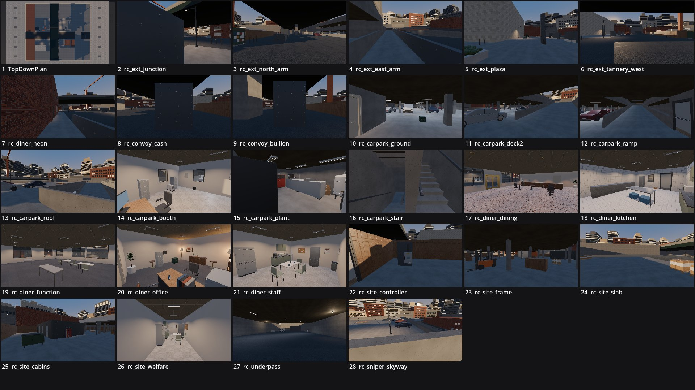

# Review shots: rolling_thunder (greybox)

Rendered by `tools/levelcheck/render_shots.sh` at 1920x1080. Contact sheet: `contact_sheet.jpg`.

| # | camera | caption | file | KB |
|---|---|---|---|---|
| 1 | TopDownPlan | TopDownPlan () | [top_down_plan.jpg](top_down_plan.jpg) | 226 |
| 2 | rc_ext_junction | rc_ext_junction (X3) | [rc_ext_junction.jpg](rc_ext_junction.jpg) | 100 |
| 3 | rc_ext_north_arm | rc_ext_north_arm (X1) | [rc_ext_north_arm.jpg](rc_ext_north_arm.jpg) | 214 |
| 4 | rc_ext_east_arm | rc_ext_east_arm (X6) | [rc_ext_east_arm.jpg](rc_ext_east_arm.jpg) | 148 |
| 5 | rc_ext_plaza | rc_ext_plaza (X3) | [rc_ext_plaza.jpg](rc_ext_plaza.jpg) | 144 |
| 6 | rc_ext_tannery_west | rc_ext_tannery_west (X1) | [rc_ext_tannery_west.jpg](rc_ext_tannery_west.jpg) | 243 |
| 7 | rc_diner_neon | rc_diner_neon (X1) | [rc_diner_neon.jpg](rc_diner_neon.jpg) | 195 |
| 8 | rc_convoy_cash | rc_convoy_cash (X1) | [rc_convoy_cash.jpg](rc_convoy_cash.jpg) | 146 |
| 9 | rc_convoy_bullion | rc_convoy_bullion (X1) | [rc_convoy_bullion.jpg](rc_convoy_bullion.jpg) | 143 |
| 10 | rc_carpark_ground | rc_carpark_ground (CP-G) | [rc_carpark_ground.jpg](rc_carpark_ground.jpg) | 119 |
| 11 | rc_carpark_deck2 | rc_carpark_deck2 (CP-2) | [rc_carpark_deck_2.jpg](rc_carpark_deck_2.jpg) | 120 |
| 12 | rc_carpark_ramp | rc_carpark_ramp (CP-G) | [rc_carpark_ramp.jpg](rc_carpark_ramp.jpg) | 103 |
| 13 | rc_carpark_roof | rc_carpark_roof (CP-R) | [rc_carpark_roof.jpg](rc_carpark_roof.jpg) | 221 |
| 14 | rc_carpark_booth | rc_carpark_booth (AB) | [rc_carpark_booth.jpg](rc_carpark_booth.jpg) | 158 |
| 15 | rc_carpark_plant | rc_carpark_plant (CPL) | [rc_carpark_plant.jpg](rc_carpark_plant.jpg) | 105 |
| 16 | rc_carpark_stair | rc_carpark_stair (STA) | [rc_carpark_stair.jpg](rc_carpark_stair.jpg) | 109 |
| 17 | rc_diner_dining | rc_diner_dining (DR) | [rc_diner_dining.jpg](rc_diner_dining.jpg) | 302 |
| 18 | rc_diner_kitchen | rc_diner_kitchen (K) | [rc_diner_kitchen.jpg](rc_diner_kitchen.jpg) | 213 |
| 19 | rc_diner_function | rc_diner_function (U1) | [rc_diner_function.jpg](rc_diner_function.jpg) | 190 |
| 20 | rc_diner_office | rc_diner_office (OF) | [rc_diner_office.jpg](rc_diner_office.jpg) | 168 |
| 21 | rc_diner_staff | rc_diner_staff (U5) | [rc_diner_staff.jpg](rc_diner_staff.jpg) | 175 |
| 22 | rc_site_controller | rc_site_controller (X4) | [rc_site_controller.jpg](rc_site_controller.jpg) | 156 |
| 23 | rc_site_frame | rc_site_frame (FG) | [rc_site_frame.jpg](rc_site_frame.jpg) | 110 |
| 24 | rc_site_slab | rc_site_slab (F1) | [rc_site_slab.jpg](rc_site_slab.jpg) | 155 |
| 25 | rc_site_cabins | rc_site_cabins (X4) | [rc_site_cabins.jpg](rc_site_cabins.jpg) | 166 |
| 26 | rc_site_welfare | rc_site_welfare (C2) | [rc_site_welfare.jpg](rc_site_welfare.jpg) | 105 |
| 27 | rc_underpass | rc_underpass (X2) | [rc_underpass.jpg](rc_underpass.jpg) | 135 |
| 28 | rc_sniper_skyway | rc_sniper_skyway () | [rc_sniper_skyway.jpg](rc_sniper_skyway.jpg) | 243 |

