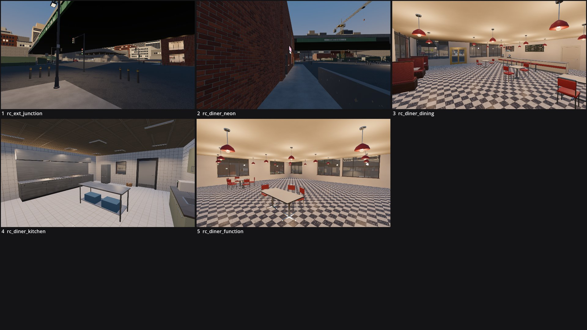

# Review shots: rolling_thunder (greybox)

Rendered by `tools/levelcheck/render_shots.sh` at 1920x1080. Contact sheet: `contact_sheet.jpg`.

| # | camera | caption | file | KB |
|---|---|---|---|---|
| 1 | rc_ext_junction | rc_ext_junction (X3) | [rc_ext_junction.jpg](rc_ext_junction.jpg) | 187 |
| 2 | rc_diner_neon | rc_diner_neon (X1) | [rc_diner_neon.jpg](rc_diner_neon.jpg) | 208 |
| 3 | rc_diner_dining | rc_diner_dining (DR) | [rc_diner_dining.jpg](rc_diner_dining.jpg) | 320 |
| 4 | rc_diner_kitchen | rc_diner_kitchen (K) | [rc_diner_kitchen.jpg](rc_diner_kitchen.jpg) | 224 |
| 5 | rc_diner_function | rc_diner_function (U1) | [rc_diner_function.jpg](rc_diner_function.jpg) | 326 |

