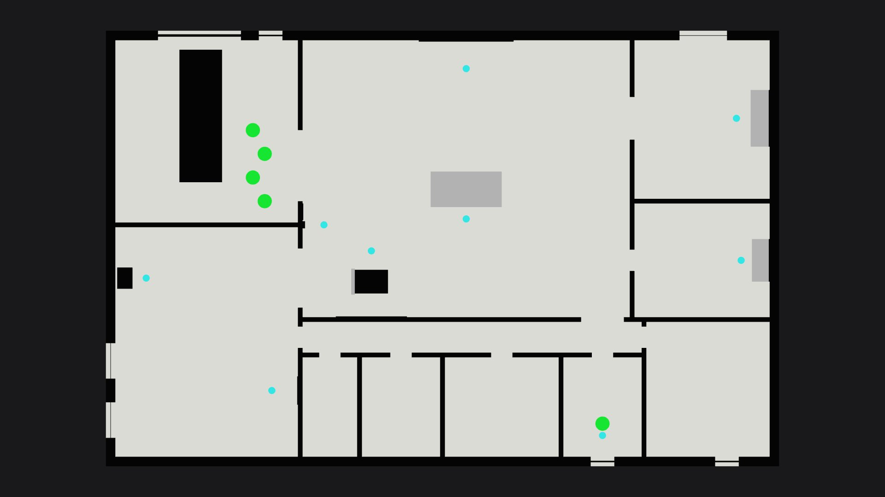

# Floor plans: Safehouse

Top-down orthographic, cut at floor + 1.5 m. Overlay: player spawns green, guards red, police blue,
civilians yellow, patrol points/links orange, loot magenta, UsePoints cyan, escape zones green, secure zones magenta.

## Ground (0.0 m)

