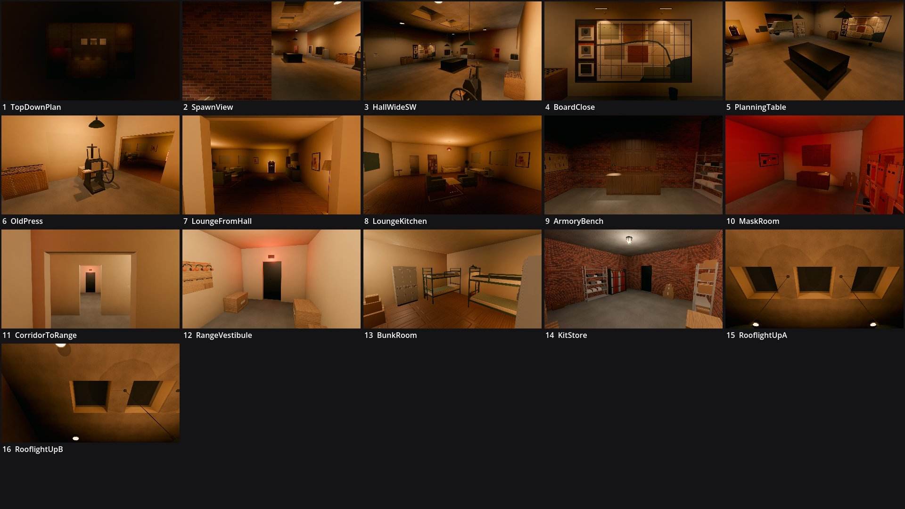

# Review shots: Safehouse (g3)

Rendered by `tools/levelcheck/render_shots.sh` at 1920x1080. Contact sheet: `contact_sheet.jpg`.

| # | camera | caption | file | KB |
|---|---|---|---|---|
| 1 | TopDownPlan | TopDownPlan (plan_top) | [top_down_plan.jpg](top_down_plan.jpg) | 50 |
| 2 | SpawnView | SpawnView (spawn_view) | [spawn_view.jpg](spawn_view.jpg) | 176 |
| 3 | HallWideSW | HallWideSW (hall_wide_sw) | [hall_wide_sw.jpg](hall_wide_sw.jpg) | 143 |
| 4 | BoardClose | BoardClose (board_close) | [board_close.jpg](board_close.jpg) | 143 |
| 5 | PlanningTable | PlanningTable (planning_table) | [planning_table.jpg](planning_table.jpg) | 145 |
| 6 | OldPress | OldPress (old_press) | [old_press.jpg](old_press.jpg) | 146 |
| 7 | LoungeFromHall | LoungeFromHall (lounge_from_hall) | [lounge_from_hall.jpg](lounge_from_hall.jpg) | 119 |
| 8 | LoungeKitchen | LoungeKitchen (lounge_kitchen) | [lounge_kitchen.jpg](lounge_kitchen.jpg) | 129 |
| 9 | ArmoryBench | ArmoryBench (armory_bench) | [armory_bench.jpg](armory_bench.jpg) | 177 |
| 10 | MaskRoom | MaskRoom (mask_room) | [mask_room.jpg](mask_room.jpg) | 106 |
| 11 | CorridorToRange | CorridorToRange (corridor_to_range) | [corridor_to_range.jpg](corridor_to_range.jpg) | 74 |
| 12 | RangeVestibule | RangeVestibule (range_vestibule) | [range_vestibule.jpg](range_vestibule.jpg) | 104 |
| 13 | BunkRoom | BunkRoom (bunk_room) | [bunk_room.jpg](bunk_room.jpg) | 154 |
| 14 | KitStore | KitStore (kit_store) | [kit_store.jpg](kit_store.jpg) | 279 |
| 15 | RooflightUpA | RooflightUpA (rooflight_up_a) | [rooflight_up_a.jpg](rooflight_up_a.jpg) | 136 |
| 16 | RooflightUpB | RooflightUpB (rooflight_up_b) | [rooflight_up_b.jpg](rooflight_up_b.jpg) | 119 |

