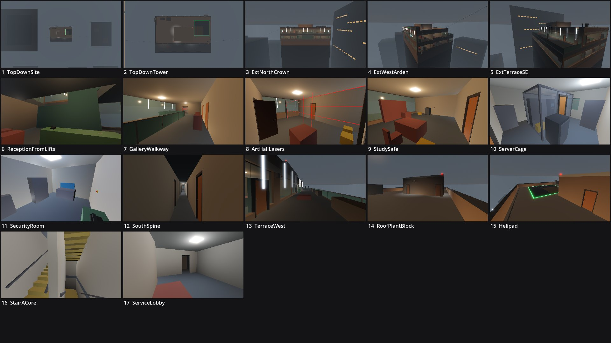

# Review shots: shadow_ledger (g1)

Rendered by `tools/levelcheck/render_shots.sh` at 1920x1080. Contact sheet: `contact_sheet.jpg`.

| # | camera | caption | file | KB |
|---|---|---|---|---|
| 1 | TopDownSite | Top-down site: Calder Tower top, Arden Tower (W), Vantage House (E), the skyline | [top_down_site.jpg](top_down_site.jpg) | 47 |
| 2 | TopDownTower | Top-down tower: roof, helipad, plant block, BMU, terrace below the south edge | [top_down_tower.jpg](top_down_tower.jpg) | 54 |
| 3 | ExtNorthCrown | Exterior: north facade (river side): the double-height reception and feature stair, the crown | [ext_north_crown.jpg](ext_north_crown.jpg) | 68 |
| 4 | ExtWestArden | Exterior: from Arden Tower: west facade, BMU and the west gondola stop, insertion line | [ext_west_arden.jpg](ext_west_arden.jpg) | 71 |
| 5 | ExtTerraceSE | Exterior: south-east: terrace, glass balustrade, caged ladder, E2 line to Vantage House | [ext_terrace_se.jpg](ext_terrace_se.jpg) | 84 |
| 6 | ReceptionFromLifts | K3 reception (landmark): guard desk, feature stair, the void up to the gallery | [reception_from_lifts.jpg](reception_from_lifts.jpg) | 61 |
| 7 | GalleryWalkway | M2 gallery walkway over the void, feature-stair arrival, art-hall doors | [gallery_walkway.jpg](gallery_walkway.jpg) | 69 |
| 8 | ArtHallLasers | M3 art hall: laser plane at x 26.5, paintings, study door | [art_hall_lasers.jpg](art_hall_lasers.jpg) | 90 |
| 9 | StudySafe | M4 study: desk, time-lock safe and its reader, gondola facade door | [study_safe.jpg](study_safe.jpg) | 77 |
| 10 | ServerCage | K11 server room: the cage, ledger rack, hack terminal, drive sleds | [server_cage.jpg](server_cage.jpg) | 85 |
| 11 | SecurityRoom | K13 security room: the operator faces the monitor wall, the door behind him | [security_room.jpg](security_room.jpg) | 63 |
| 12 | SouthSpine | K16 south spine: the 36 m sightline | [south_spine.jpg](south_spine.jpg) | 53 |
| 13 | TerraceWest | X1 terrace: sliders, C12 bay, outdoor kitchen, the SE caged ladder | [terrace_west.jpg](terrace_west.jpg) | 77 |
| 14 | RoofPlantBlock | Roof spawn (SW): the plant block, head-house and riser-bay doors | [roof_plant_block.jpg](roof_plant_block.jpg) | 54 |
| 15 | Helipad | Roof: helipad (E1) and the E2 anchor | [helipad.jpg](helipad.jpg) | 69 |
| 16 | StairACore | Stair A at L41 (U-stair, 0.3 m core walls) | [stair_a_core.jpg](stair_a_core.jpg) | 69 |
| 17 | ServiceLobby | L40 service lobby (PUBLIC): service lift car (E3), service spawn | [service_lobby.jpg](service_lobby.jpg) | 59 |

